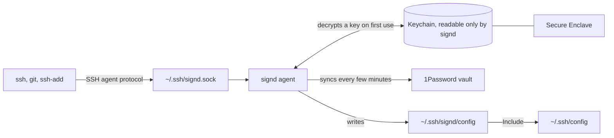
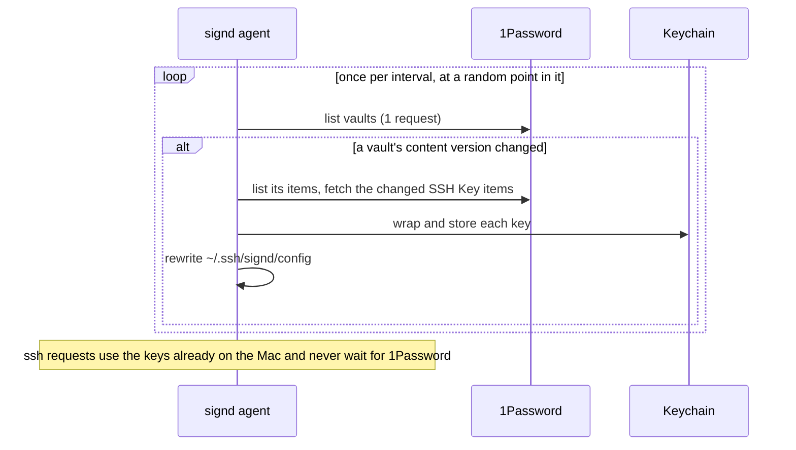

# signd

An SSH agent for macOS backed by the Secure Enclave.  
Create new keys, import the Ed25519, ECDSA and RSA keys you already have, or sync SSH keys from a 1Password vault.



Listing keys takes under a millisecond, and a Secure Enclave signature about 5 ms.  
No command can export a private key.

## Install

Each release attaches `signd.pkg`, signed with a Developer ID, notarized and stapled, which installs `/Applications/Signd.app`.  
Its provisioning profile gives the app a keychain access group of its own.  
The Homebrew cask links `signd` onto the PATH.

Then start the agent and point SSH at it:

```sh
signd service enable                     # run the agent at login, on ~/.ssh/signd.sock
export SSH_AUTH_SOCK=~/.ssh/signd.sock   # or IdentityAgent ~/.ssh/signd.sock in ~/.ssh/config
```

> [!IMPORTANT]
> For keys with hosts, add this line to `~/.ssh/config`, before any `Host` block:
>
> ```text
> Include ~/.ssh/signd/config
> ```

## Keys

```sh
signd key create work --host github.com      # a Secure Enclave P-256 key; prints its public key
signd key create ci --type ed25519           # an Ed25519 key, sealed to the Secure Enclave; also rsa-3072 and rsa-4096
signd key import old ~/.ssh/id_rsa           # an existing OpenSSH, PKCS#1, PKCS#8 or SEC1 private key file
signd key import ci - < ci_ed25519           # the same from stdin, for a key that has no passphrase
signd key list
signd key delete old
```

| Key type | Stored as | `key create` | `key import` |
|:--|:--|:--|:--|
| P-256 | Secure Enclave key | default | yes, as a wrapped key |
| Ed25519 | wrapped key | `--type ed25519` | yes |
| ECDSA P-384, P-521 | wrapped key | no | yes |
| RSA, 2048 to 8192 bits | wrapped key | `--type rsa-3072`, `--type rsa-4096` | yes |
| RSA under 2048 bits, DSA | not supported; signd names the type in its error | no | no |

The Secure Enclave only supports P-256, so signd encrypts every other key with a Secure Enclave key:


To import a key with a passphrase, pass its file path.  
signd runs the system `ssh-add` to ask for the passphrase and decrypt the key, then receives it over a socket only you can open.  
The decrypted key is never written to disk.

| Added with | Stored in | Removed with |
|:--|:--|:--|
| `signd key create`, `signd key import` | the keychain | `signd key delete` |
| `ssh-add` | memory only, respecting `ssh-add -t` | `ssh-add -D` |
| 1Password | the keychain, as a wrapped key | deleting it from the vault, or `signd logout` |

## Keys from 1Password

With a 1Password service account token, signd syncs SSH keys from a vault, without the 1Password CLI or a helper process.



### Set up

1. Make a vault with only SSH Key items and the `signd` note, so edits to other items never change its content version.
2. Make a service account that can read only that vault.
   > [!NOTE]
   > On a Business account, each token gets 10,000 reads an hour, and all service accounts together 50,000 requests a day.
3. Sign in with its token, read from stdin:

   ```sh
   pbpaste | signd login
   ```

### Items

signd syncs every SSH Key item in every vault the token can read.

| Field | Purpose | Format |
|:--|:--|:--|
| Title | the key name | lowercase, with every character other than ASCII letters, digits, `-` and `_` turned into `-` |
| `hosts`, optional text | hosts that use the key | separated by commas; letters, digits, `.`, `-`, `_`, `*` and `?` |
| `macs`, optional text | Macs that get the key | each Mac's `LocalHostName`, separated by commas or spaces; without it, every Mac |

signd skips an item it cannot use and lists it in `signd status` with the reason:

- a local key already has its name;
- `hosts` contains an invalid character;
- the key cannot be read, for example because it has a passphrase.

```sh
signd sync                           # check 1Password now, wait, and print what changed
signd status                         # signed in or not, the interval and its source, the last and next check, skipped items
signd logout                         # delete the token and every synced key, and stop a check in flight; local keys stay
```

## Settings

| Setting | Default | Range | Controls |
|:--|:--|:--|:--|
| `interval` | 5m | 1 minute to 24 hours | how often signd syncs with 1Password |
| `key-lifetime` | 1h | 1 second to 30 days | how long a decrypted key stays in memory when idle |

- `signd config set interval 10m` sets a value on this Mac, and `signd config unset interval` removes it.
- A Secure Note titled `signd` in a synced vault sets fleet values in text fields with these names, as `30s`, `5m`, `1h` or `2d`.
- A value set on the Mac wins over the note.
- signd rejects a value out of range, and ignores one in the note, showing it in `signd status`.

A sync with no changes costs one request.  
A failed sync is retried after growing, randomized waits.  
After a rate limit, signd waits at least an hour before the next sync.

## Operation

| Part | Behaviour |
|:--|:--|
| Service | `signd service enable` registers the agent's LaunchAgent with `SMAppService`; launchd runs `signd serve` at login and restarts it if it exits. |
| Protocol | The SSH agent protocol (RFC 9987): list, sign, add, remove, and the `query` and `session-bind@openssh.com` extensions. Lock, confirm and every other request are refused. |
| Locked Mac | Keys work without a prompt once the Mac has been unlocked after boot, so signd also signs on a locked or headless Mac. |
| Output | Every command that prints data takes `--json`. |

## Development

`openspec/` contains the requirements and the planned changes, and `tasks.yaml` is the work queue.  
CI builds and tests on GitHub-hosted runners.

> [!NOTE]
> GitHub-hosted runners have no Secure Enclave, so `mise run e2e:hardware` tests Secure Enclave keys on a Mac before each release.

## License

[GNU Affero General Public License v3.0](LICENSE).
