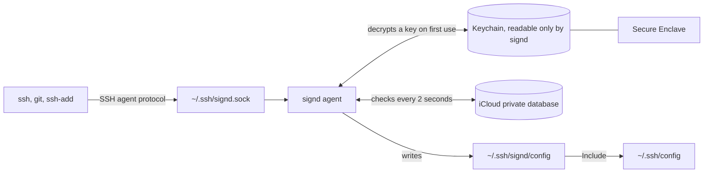
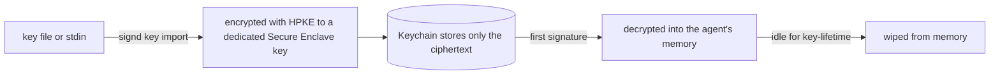
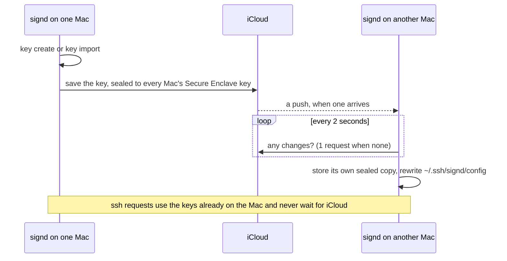

# signd

An SSH agent for macOS backed by the [Secure Enclave][secure-enclave].  
Create new keys or import the Ed25519, ECDSA and RSA keys you already have, and share them through iCloud with every Mac on your Apple account.



Listing keys takes under a millisecond, and a Secure Enclave signature about 5 ms.  
No command can export a private key.

## Install

Each release attaches `signd.pkg`, signed with a Developer ID, notarized and stapled, which installs `/Applications/Signd.app`.  
The app's provisioning profile grants it a private keychain access group.  
The Homebrew cask links `signd` onto the PATH.

Then start the agent and point SSH at it:

```sh
signd service enable                     # run the agent at login, on ~/.ssh/signd.sock
export SSH_AUTH_SOCK=~/.ssh/signd.sock   # or IdentityAgent ~/.ssh/signd.sock in ~/.ssh/config
```

> [!IMPORTANT]
> For keys with hosts, add this line to `~/.ssh/config`, before any `Host` block:
>
> ```text
> Include ~/.ssh/signd/config
> ```

## Keys

```sh
signd key create work --host github.com      # a Secure Enclave P-256 key; prints its public key
signd key create ci --type ed25519           # an Ed25519 key, sealed to the Secure Enclave; also rsa-3072 and rsa-4096
signd key import old ~/.ssh/id_rsa           # an existing OpenSSH, PKCS#1, PKCS#8 or SEC1 private key file
signd key import ci - < ci_ed25519           # the same from stdin, for a key that has no passphrase
signd key list
signd key delete old
```

| Key type | Stored as | `key create` | `key import` |
|:--|:--|:--|:--|
| P-256 | Secure Enclave key | default | yes, as a wrapped key |
| Ed25519 | wrapped key | `--type ed25519` | yes |
| ECDSA P-384, P-521 | wrapped key | no | yes |
| RSA, 2048 to 8192 bits | wrapped key | `--type rsa-3072`, `--type rsa-4096` | yes |
| RSA under 2048 bits, DSA | not supported | no | no |

The Secure Enclave only supports P-256, so signd encrypts every other key with a Secure Enclave key:



To import a key with a passphrase, pass the file path.  
signd runs the system `ssh-add` to ask for the passphrase and decrypt the key, then receives it over a socket only you can open.  
The decrypted key is never written to disk.

| Added with | Stored in | Removed with |
|:--|:--|:--|
| `signd key create`, `signd key import` | the keychain | `signd key delete` |
| `ssh-add` | memory only, respecting `ssh-add -t` | `ssh-add -D` |
| another Mac, through iCloud | the keychain, as a wrapped key | `signd key delete` on any Mac |

## Keys through iCloud

signd shares keys between the Macs signed in to one Apple account, through that account's iCloud private database.
Each Mac makes its own Secure Enclave key, and every shared key is sealed to each Mac's key before it leaves the Mac, so neither Apple nor the signd team can read it.



| Key | Shared |
|:--|:--|
| `key create --type ed25519`, `rsa-3072`, `rsa-4096` | yes, unless `--local` |
| `key import` | yes, unless `--local` |
| `key create`, a Secure Enclave P-256 key | never: it cannot leave the Mac |
| added with `ssh-add` | never: it stays in memory |

```sh
signd key import deploy ~/.ssh/deploy --host git.example.com   # stored here, and shared with every Mac
signd key create scratch --type ed25519 --local                # stays on this Mac
signd key share old                                            # share a key made before
signd key delete deploy                                        # deleted on every Mac
signd device list                                              # the Macs on the account
signd device remove device-0123…                               # forget a Mac that is gone, and drop its copies
signd sync                                                     # check iCloud now, wait, and print what changed
signd status                                                   # iCloud state, the last and next check, keys waiting or skipped
```

- A new Mac on the account gets every shared key at the next check of a Mac that has them, with no command on either Mac.
- A check with no change costs one request. After a failure signd waits longer each time, up to a minute, and after a throttle it waits the time iCloud gives.
- A key whose name a key on this Mac already has is skipped and shown in `signd status` until that key is deleted.
- Signing in to another Apple account, or deleting signd's data in iCloud settings, removes the shared keys from the Mac; local keys stay.

> [!NOTE]
> Sharing needs the notarized release: only its provisioning profile grants signd's iCloud container. A build from source keeps every key on its Mac, and `signd status` shows sync as off.

## Settings

| Setting | Default | Range | Controls |
|:--|:--|:--|:--|
| `interval` | 2s | 1 second to 1 hour | how often signd checks iCloud for changes |
| `key-lifetime` | 1h | 1 second to 30 days | how long a decrypted key stays in memory when idle |

- `signd config set interval 10s` sets a value on this Mac, and `signd config unset interval` removes it.
- Values are durations such as `30s`, `5m`, `1h` or `2d`; signd rejects one out of range.

## Operation

| Part | Behaviour |
|:--|:--|
| Service | `signd service enable` registers the agent's LaunchAgent with `SMAppService`; launchd runs `signd serve` at login and restarts it if it exits. |
| Protocol | The SSH agent protocol (RFC 9987): list, sign, add, remove, and the `query` and `session-bind@openssh.com` extensions. Lock, confirm and every other request are refused. |
| Locked Mac | Keys work without a prompt once the Mac has been unlocked after boot, so signd also signs on a locked or headless Mac. |
| Output | Every command that prints data takes `--json`. |

## Development

`openspec/` contains the requirements and the planned changes, and `tasks.yaml` is the work queue.  
CI builds and tests on GitHub-hosted runners.

> [!NOTE]
> GitHub-hosted runners have no Secure Enclave, so `mise run e2e:hardware` tests Secure Enclave keys on a Mac before each release.

## License

[GNU Affero General Public License v3.0](LICENSE).

[secure-enclave]: https://support.apple.com/guide/security/the-secure-enclave-sec59b0b31ff/web
